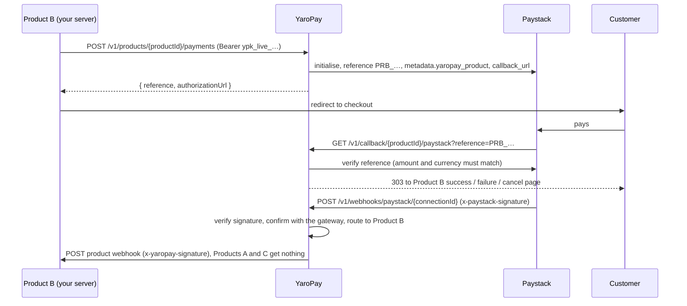

# YaroPay

Open-source, self-hosted payment orchestration for companies that run several products on one payment gateway account.

A company installs YaroPay once, adds its payment gateway keys ([see the gateways](#gateways)), and connects every website, SaaS app and mobile app to it. Each product gets its own API keys, signing secret, callback URLs and webhook endpoint. YaroPay ties every payment to the product that started it, so sales, payments and webhooks stay separate per product even though they all go through the same gateway account.

- **Multi-product routing.** A gateway sends every event for an account to one URL. YaroPay matches each event to its product (by known reference, `metadata.yaropay_product`, then reference prefix) and forwards it to that product only. Events that match nothing are held as *unrouted*.
- **Real gateway integrations.** Each gateway adapter starts payments, verifies them with the gateway, reads callbacks, checks webhook signatures and tests keys. See [Gateways](#gateways).
- **Signed deliveries with retries.** Every event YaroPay forwards is signed (`x-yaropay-signature: t=…,v1=…`), retried 8 times over about 45 hours, and can be replayed from the dashboard.
- **Auth, roles and product scope.** Email and password sign-in, invites, password reset, sessions you can revoke. Five roles (owner, admin, developer, finance, viewer), and members can be limited to some products.
- **Notifications.** In-app with a live bell (server-sent events), email, and an alerts webhook for Slack, Discord or Teams. Each member picks channels per event type.
- **Dashboard.** Revenue by product, gateway split per product, transactions with a routing timeline, webhook deliveries, audit log. Light and dark, Test and Live modes.

## Gateways

| Gateway | Status | Currencies | Notes |
|---|---|---|---|
| Paystack | Available | NGN, GHS, KES, ZAR, USD | |
| Flutterwave | Available | NGN, GHS, KES, ZAR, USD | |
| Stripe | Beta | 130+, including USD, EUR, GBP, NGN, JPY | Stripe Checkout (hosted page). Add the webhook endpoint's signing secret after installing. |
| PayPal | Beta | 24, including USD, EUR, GBP, JPY, AUD | PayPal Orders v2: YaroPay captures the order when the customer returns or PayPal reports the approval. Add the webhook ID after installing. |
| Monnify | Coming soon | | |
| Korapay | Coming soon | | |

**Available** gateways have been confirmed with real sandbox payments. **Beta** gateways are fully usable but
were built from the gateway's documentation and haven't yet been confirmed with a real sandbox payment;
the dashboard marks them, and reports from your first test payments are very welcome. Every gateway is free
in every edition.

## How a payment flows



Whichever arrives first (the customer's callback or the gateway webhook) settles the payment. Each status change produces exactly one event for the product.

## Documentation

- [How YaroPay works](https://yaropay.com/docs/how-it-works): who sets up what, the payment flow, how events reach the right product.
- [Integrating a product](https://yaropay.com/docs/integrating-a-product): API keys, starting payments, redirects, verifying events, moving an existing Paystack integration, direct mode.
- [Security model](https://yaropay.com/docs/security): how forged requests are stopped, what each party must protect, an operator checklist.

All docs are at [yaropay.com/docs](https://yaropay.com/docs). They live in their own repository,
[Round24Consult/yaropay-docs](https://github.com/Round24Consult/yaropay-docs): a change that alters
behaviour should come with a docs pull request there.

## Quick start

### Local development (no database to install)

```bash
npm install
npm run dev          # core + API on :4000 + dashboard on :3000
```

Open http://localhost:3000. A fresh install starts empty and asks you to create the owner account, then shows a short tour. From there you either set up for real, with a setup guide on the dashboard that ticks off each step when the API sees it happen (public URL, gateway keys, first signed gateway event, first product, a successful test payment, a delivered product webhook), or load sample data to look around.

Sample data is a made-up company with three products, gateway accounts with fake keys and about a year of payments. Every sample row is flagged, a banner stays up while it is loaded, the delivery worker never sends to its made-up hosts, and real products can't use the sample gateway accounts. It can only be loaded into an empty install (from the tour, the empty dashboard, **Settings > General** or `npm run db:seed`) and is removed in one click from the banner or Settings, leaving your own products, accounts and team untouched. The API uses an embedded Postgres ([PGlite](https://pglite.dev)) in `apps/api/.data/pglite` until you set `DATABASE_URL`. Without `SMTP_URL`, emails (invites, resets) are printed to the API log, and invite links can be copied from **Settings > Team**.

### Docker

```bash
cp .env.example .env            # set YAROPAY_ENCRYPTION_KEY (openssl rand -base64 32)
docker compose up -d --build
```

This runs Postgres, the API, the dashboard (http://localhost:3000) and Mailpit (http://localhost:8025) for email. For a real deployment, put the dashboard behind HTTPS, set `YAROPAY_BASE_URL` to the public URL, and point `SMTP_URL` at your mail provider.

### Hosted edition (our server)

`deploy/` holds the production setup for the hosted edition: `compose.yml` (Caddy with automatic HTTPS, the dashboard, the API, Postgres and nightly `pg_dump` backups), the `Caddyfile`, and `bootstrap.sh`, which prepares a fresh Ubuntu server once (security updates, Docker, firewall, fail2ban, a `deploy` user and a server-only `.env` with generated secrets).

`.github/workflows/deploy.yml` runs after CI passes on `main`: it builds both images, pushes them to `ghcr.io/round24consult/yaropay-{api,web}` and restarts the stack over SSH. It stays off until the repository variable `DEPLOY_HOST` is set. Run it by hand with a commit SHA to roll back.

### Receiving gateway webhooks locally

Gateways cannot reach `localhost`. Run a tunnel (for example `cloudflared tunnel --url http://localhost:3000`), set the tunnel URL as the base URL in **Settings > General**, and paste the webhook URL from **Apps** into the Paystack or Flutterwave dashboard. Customer redirects work without a tunnel.

## Generated URLs

Every URL derives from the base URL in **Settings > General**.

| URL | Where it goes | Scope |
| --- | --- | --- |
| `{base}/v1/webhooks/{gateway}/{connectionId}` | Paste into the gateway dashboard | One per installed gateway account |
| `{base}/v1/callback/{productId}/{gateway}` | Set by YaroPay as `callback_url` (Paystack) / `redirect_url` (Flutterwave) | One per product and gateway |
| `{base}/v1/callback/{productId}/{gateway}?outcome=cancelled` | Paystack `metadata.cancel_action` | Gateways with a cancel URL |
| `{base}/v1/callback/{gateway}/{connectionId}` | Optional fallback callback in the gateway dashboard | One per gateway account |
| `{base}/v1/products/{productId}/payments` | Your server creates payments here | One per product |

## Integrating a product

Each product has a live key (`ypk_live_…`) and a test key (`ypk_test_…`). The key decides the mode: a test key uses the product's test gateway accounts.

**Start a payment** (server side):

```bash
curl https://payments.example.com/v1/products/prd_x/payments \
  -H "Authorization: Bearer $YAROPAY_API_KEY" \
  -H "Idempotency-Key: order-1042" \
  -H "Content-Type: application/json" \
  -d '{ "amount": 1500000, "currency": "NGN", "email": "customer@example.com", "metadata": { "orderId": "1042" } }'
```

`amount` is in minor units of the currency (kobo, cents; yen have none). Optional: `name`, `gateway` (`default` or an installed gateway's id, such as `paystack` or `flutterwave`), `reference` (must start with the product prefix), `channels`. The response has `reference`, `authorizationUrl` and `status`. Repeating a request with the same `Idempotency-Key` returns the same payment. `GET /v1/products/{productId}/payments/{reference}?refresh=1` re-checks a pending payment with the gateway.

**After checkout** the customer lands on your success, failure or cancel page with `?reference=…&status=success|failed|cancelled|pending&payment_id=…`. Treat the redirect as a hint and fulfil orders from the webhook.

**Receive events** at the product's webhook endpoint. Types: `payment.succeeded`, `payment.failed`, `payment.abandoned`, `payment.reversed`, `test.ping`. Verify the signature:

```js
import crypto from "node:crypto"

export async function POST(req) {
  const raw = await req.text()
  const header = req.headers.get("x-yaropay-signature") ?? ""
  const parts = Object.fromEntries(header.split(",").map((p) => p.split("=")))
  const expected = crypto.createHmac("sha256", process.env.YAROPAY_SIGNING_SECRET).update(`${parts.t}.${raw}`).digest("hex")
  const fresh = Math.abs(Date.now() / 1000 - Number(parts.t)) < 300
  const ok = fresh && parts.v1?.length === expected.length && crypto.timingSafeEqual(Buffer.from(parts.v1), Buffer.from(expected))
  if (!ok) return new Response("bad signature", { status: 401 })
  const event = JSON.parse(raw)
  if (event.type === "payment.succeeded") await markOrderPaid(event.data.metadata.orderId, event.data.reference)
  return Response.json({ received: true })
}
```

Headers also include `x-yaropay-event` and `x-yaropay-delivery` (use the delivery id to ignore duplicates). Any 2xx answer counts as delivered; anything else is retried after 1 min, 5 min, 30 min, 2 h, 6 h, 12 h and 24 h.

**Direct mode.** A product can call the gateway itself if it uses its YaroPay callback URL, a `PREFIX_` reference and `metadata.yaropay_product`. YaroPay records those payments when the callback or webhook arrives.

## Workspaces

Everything (gateway accounts, products, payments, webhooks, team, settings and the audit log) belongs to a
workspace: one company. A self-hosted Community install has one workspace. YaroPay Cloud and Enterprise
installs can hold several, and one person can belong to more than one and switch between them in the
sidebar. Every query is limited to the signed-in member's workspace, `apps/api/test/isolation.e2e.test.ts`
checks every route for leaks between companies, and the database refuses links between rows of different
workspaces. Public endpoints (payments API, callbacks, gateway webhooks) find the workspace from the
product, API key or gateway account they name.

## Roles and product scope

| Permission | Owner | Admin | Developer | Finance | Viewer |
| --- | :-: | :-: | :-: | :-: | :-: |
| Dashboard, payments, products, gateways, webhooks, settings, team (read) | ✓ | ✓ | ✓ | ✓ | ✓ |
| Export payments (CSV) | ✓ | ✓ | ✓ | ✓ | |
| Audit log | ✓ | ✓ | ✓ | ✓ | |
| Edit products, rotate product keys, send test events, replay deliveries | ✓ | ✓ | ✓ | | |
| Delete products | ✓ | ✓ | | | |
| Install, rotate and remove gateway accounts | ✓ | ✓ | | | |
| Change settings, manage the team | ✓ | ✓ | | | |

Owners can manage everyone; admins can manage developers, finance and viewers. The last owner can't be removed. Developers, finance and viewers can be limited to some products: they then see only those products' payments, deliveries and analytics, and can't create products. The table lives in `packages/core/src/auth.ts`, shared by the API and the dashboard.

## Notifications

| Event | Who gets it | Default |
| --- | --- | --- |
| Webhook delivery failed (warning after 3 failures, critical after the last) | `webhooks:read`, product scope applies | in-app, email, alert |
| Unrouted gateway event | `webhooks:read`, unscoped members | in-app |
| Invalid webhook signature | `gateways:write` | in-app, email, alert |
| Gateway rejected a request (bad keys) | `gateways:read` | in-app, email, alert |
| Keys rotated | `products:keys` | in-app |
| New team member | `team:read` | in-app |
| New sign-in to your account | the member | in-app, email |

Members change channels in **Settings > Notifications**. Set an incoming-webhook URL in **Settings > General** to post alerts to Slack, Discord, Teams or Mattermost. Emails and alert posts go through a Postgres-backed outbox with retries.

## Configuration

API (`apps/api`, see `apps/api/.env.example`):

| Variable | Default | Purpose |
| --- | --- | --- |
| `DATABASE_URL` | empty | Postgres connection string. Empty uses embedded PGlite in `PGLITE_DIR`. |
| `YAROPAY_ENCRYPTION_KEY` | dev key | 32 bytes, base64. Encrypts gateway keys, signing secrets and the alerts URL. **Required in production.** |
| `SETUP_TOKEN` | none | When set, creating the first (owner) account needs it, from `/setup?token=…` or the setup form. **Set it on any install reachable from the internet**, or whoever opens `/setup` first becomes the owner. |
| `DASHBOARD_URL` | `http://localhost:3000` | CORS, CSRF origin check, links in emails |
| `YAROPAY_BASE_URL` | `http://localhost:4000` | Public base URL suggested on first run (editable in Settings) |
| `SMTP_URL`, `MAIL_FROM` | empty | Email delivery. Empty prints emails to the log. |
| `COOKIE_SECURE` | `auto` | Secure session cookie (on in production) |
| `TRUST_PROXY` | `loopback` | Express `trust proxy`, for client IPs behind a proxy |
| `WEBHOOK_ALLOW_PRIVATE` | on in dev, off in production | Allow product webhook URLs on private networks |
| `WORKERS` | on | Delivery and outbox workers. Several API instances can share them. |
| `RATE_LIMIT` | on | Per-IP limits on sign-in, reset and invite endpoints |
| `<ID>_API_URL` (`PAYSTACK_API_URL`, `FLUTTERWAVE_API_URL`, ...) | the gateway's own API | Send one gateway's API calls through a proxy or to another host |

Dashboard (`apps/web`): `YAROPAY_API_URL` (default `http://localhost:4000`). The dashboard proxies `/api` and `/v1` to the API so the session cookie stays first-party. Next.js compiles rewrites at build time, so set it before `next build` (the Dockerfile takes it as a build argument).

## Security notes

- Gateway secrets, product signing secrets and the alerts URL are encrypted with AES-256-GCM. API keys are stored as SHA-256 hashes and shown once.
- Passwords use scrypt (N=2^16, r=8, p=2). Sessions are random tokens in an httpOnly, SameSite=Lax cookie, stored hashed, revocable, and all signed out on password change or reset.
- State-changing dashboard requests must come from the dashboard origin. Sign-in, reset and invite endpoints are rate limited.
- Gateway webhooks are verified before anything else; successful payments are also confirmed through the gateway API, and the amount and currency must match what the product asked for.
- Product webhook URLs that resolve to private addresses are refused in production (`WEBHOOK_ALLOW_PRIVATE`), and redirects are not followed.
- Products with live payments can't be deleted (pause them instead), so payment history stays intact.

## Project layout

```
packages/core/       framework-free domain code shared by API and dashboard
  src/auth.ts          roles, permissions, auth schemas
  src/notifications.ts notification catalogue
  src/payments.ts      public API schemas, product events, signature format
  src/gateways/        one folder per gateway (its definition drives the install forms), registry, credential schemas
  src/currencies.ts    ISO 4217 currencies and their decimal places
  src/urls.ts, routing.ts, analytics.ts, api.ts
apps/api/            NestJS 12 API (ESM)
  src/auth, team       sessions, guards, invites, roles, product scope
  src/gateways         one folder per gateway adapter (with its contract tests and fixtures), the gateway kit, gateway accounts
  src/payments         product API, callbacks, gateway webhook ingestion, settlement
  src/webhooks         signed deliveries, retry worker, events
  src/notifications    in-app + SSE, email, alerts, outbox
  src/products, transactions, analytics, settings, audit
  src/database         Drizzle schema; migrations in drizzle/
  test/                API tests against an in-memory database and a fake gateway network
apps/web/            Next.js 16 dashboard
  e2e/                 Playwright tests against the real API, and the website screenshots
deploy/              production stack for the hosted edition
```

## Development

```bash
npm run typecheck    # all workspaces
npm run lint
npm test             # core unit tests + API tests (in-memory PGlite, fake Paystack/Flutterwave)
npm run e2e          # Playwright: real API on a throwaway database + production dashboard build (can run next to `npm run dev`)
npm run screenshots  # refresh the website's screenshots (light and dark) in ../yaropay-site
npm run db:generate  # new migration after editing apps/api/src/database/schema.ts
npm run db:migrate
```

`TEST_DATABASE_URL=postgres://… npm run test:pg -w @yaropay/api` runs the API suite against real Postgres.

## Adding a gateway

Every gateway is free in every edition, and new ones are welcome. `npm run gateway:new -- <id> "<Name>"`
creates the two files to fill in (the definition and the server adapter) with a contract test and a
fixtures folder, and registers them. [docs/adding-a-gateway.md](docs/adding-a-gateway.md) walks through it.

## Not yet

Refunds from the dashboard, custom roles, several companies per install, Flutterwave v4 (OAuth), more gateways (see [Gateways](#gateways)), an OpenAPI document.

## Editions and the paid build

The paid server code (Enterprise and Cloud) lives in the private
[yaropay-ee](https://github.com/Round24Consult/yaropay-ee) repository, mounted here as a git submodule at
`apps/api/src/ee`. The app finds it at start-up; without it, it runs as Community. Nothing outside that
folder imports from it, so a plain clone builds, tests and runs on its own.

```bash
git clone git@github.com:Round24Consult/yaropay.git                       # Community
git clone --recurse-submodules git@github.com:Round24Consult/yaropay.git  # with the paid build (needs access)
```

The API logs the edition when it starts. `YAROPAY_DISABLE_EE=true` runs a paid build as Community.
Paid routes are gated with `@RequireFeature(...)`, and `GET /api/entitlements` tells the dashboard what
the active company may use. Licences, extension points and their rules are described in the yaropay-ee
README.
## Licence

YaroPay is open core.

- **Community edition**: everything in this repository outside folders named `ee` is licensed under the
  [GNU Affero General Public License v3](LICENSE). You can self-host and change it freely; if you offer a
  modified version to others over a network, you must publish your changes under the same licence.
- **Enterprise and Cloud editions**: files in `ee` folders (such as `ee/` and `apps/web/src/ee/`) and the
  private server module are under the [YaroPay Enterprise License](ee/LICENSE.md). Production use needs
  a YaroPay Enterprise licence key or a YaroPay Cloud subscription.

Contributions need a signed [contributor licence agreement](CLA.md); see [CONTRIBUTING.md](CONTRIBUTING.md).
